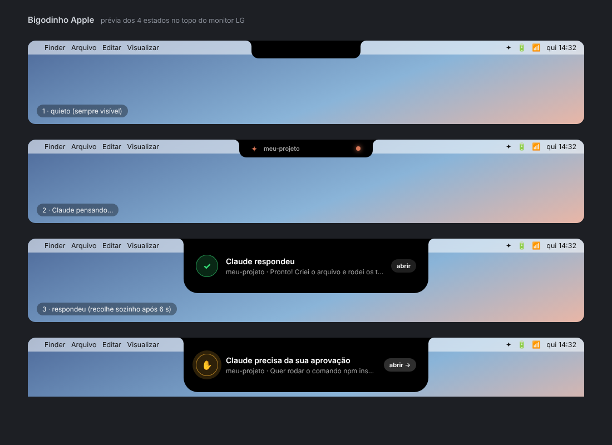

# ✦ Claude Notch · Claude Code

**English** · [Português](README.pt-BR.md)

A MacBook-style notch drawn at the top of your external monitor, wired **only to Claude Code**.
When Claude finishes a reply, or needs your approval, the notch expands with a Dynamic Island
animation and tells you what happened and in which chat. Click it and it takes you to that chat.

```
   ┌────────────────────────────────┐          ┌──────────────────────────────────────────────┐
   │        ▄▄▄▄▄▄▄▄▄▄▄▄▄▄          │   →      │   ✓  Claude replied                    open  │
   │         quiet at the top       │          │      my-project · Done! I created the file…  │
   └────────────────────────────────┘          └──────────────────────────────────────────────┘
```

Native macOS menu-bar app: Swift + SwiftUI, no dependencies. The interface is in English or Portuguese.

## What it does



| Moment in Claude Code                    | Notch                                                                   |
|------------------------------------------|-------------------------------------------------------------------------|
| You send a prompt                        | Pulsing orange dot + project name (can be turned off)                   |
| Claude finishes its reply                | Expands with a green ✓, the first line of the reply, a sound, then collapses |
| Claude asks for permission               | Expands with a pulsing amber ✋ and **stays** until you click or approve |
| Claude is idle, waiting for you          | Expands with a blue 💬                                                  |
| Click the notch                          | Opens a glass panel with one row per active chat: state color, what it is doing, and an estimated % while it thinks |
| Click a row in the panel                 | Opens that chat in the Claude app; otherwise brings its Terminal / iTerm / Warp / VS Code / Cursor to the front |

Pick which chats count: menu ✦ → **Chats (projetos)**. Every folder where you use Claude Code
shows up there with a toggle. With several monitors you can show the notch on one, several, or all.
The interface is in English or Portuguese: it follows your Mac's language, or pick one under ✦ → Language.

## Install

Requirements: macOS 13 or newer and Apple's **Command Line Tools** (the installer asks for them if
missing; it is the Swift compiler, you do not need full Xcode).

1. Download or clone this repository.
2. Double-click **`instalar.command`**. macOS opens Terminal, the script compiles and installs
   everything (about 2 minutes the first time). Or run it yourself:

   ```bash
   cd path/to/this/repo && bash instalar.command
   ```

   If macOS says the file "cannot be opened because it is from an unidentified developer",
   right-click → **Open**.
3. Quit and reopen Claude Code in each terminal so it loads the hooks.
4. A notch appears at the top of your monitor and a ✦ in the menu bar.

The installer puts:

| Where                                                 | What                                                    |
|-------------------------------------------------------|---------------------------------------------------------|
| `~/Applications/Bigodinho Apple.app`                  | the app (starts at login)                               |
| `~/.bigodinho/hook.sh`                                | the hook Claude Code calls                              |
| `~/.claude/settings.json`                             | hooks added (a `.bak-…` backup is saved next to it)     |
| `~/Library/LaunchAgents/br.com.bigodinho.apple.plist` | login item                                              |

The repository folder can live anywhere (even an external disk): the installed app does not depend on it.
To remove everything, double-click **`desinstalar.command`**. It removes the app, the login item and
the hooks, and leaves the rest of your `settings.json` intact.

## How it works

```
Claude Code ──hook (Stop / Notification / UserPromptSubmit…)──▶ ~/.bigodinho/hook.sh
                                                                     │ curl POST (JSON)
                                                                     ▼
                                                   Bigodinho Apple.app  127.0.0.1:47321
                                                                     │
                                                                     ▼
                                                       notch at the top of the monitor
```

- The app listens on **127.0.0.1 only** (nothing leaves your Mac) and only reads Claude Code events.
  The local endpoint has no authentication token, so any process on your Mac can post to it.
- The hook prints nothing and always exits 0, so it never interferes with the conversation.
- The Claude Code JSON carries `cwd` (the chat folder) and `session_id`, which is how the app
  knows which chat an event belongs to.
- The hook also sends `TERM_PROGRAM`, `__CFBundleIdentifier`, `CLAUDE_CODE_HOST_SESSION_ID` and
  `CLAUDE_CODE_ENTRYPOINT`. With the Claude app session id, a click opens that exact chat
  (`claude://claude.ai/epitaxy/<id>`); without it, the terminal is brought to the front.

Code lives in `app/Sources/BigodinhoApple/`:

| File                    | Role                                                   |
|-------------------------|--------------------------------------------------------|
| `NotchView.swift`       | the notch drawing, the chat panel and the animations   |
| `NotchController.swift` | decides what to show, places it on the monitor, timers |
| `NotchState.swift`      | phases, metrics and panel rows                         |
| `NotchPanel.swift`      | the borderless window                                  |
| `EventServer.swift`     | tiny local HTTP server                                 |
| `NotchEvent.swift`      | turns the hook JSON into events                        |
| `AppDelegate.swift`     | ✦ menu and HTTP routes (`/ping`, `/test`, `/event`)    |
| `Settings.swift`        | preferences                                            |

`testar.command` runs every animation in sequence, and `http://127.0.0.1:47321/test?kind=open|done|approval|thinking|waiting`
triggers one by hand.

## Troubleshooting

- **Nothing shows when Claude replies.** Reopen Claude Code (hooks load on start). Then run
  `testar.command`: if the animations appear, the app is fine and the problem is the hook. In a chat,
  type `/hooks` and check that `~/.bigodinho/hook.sh` is listed.
- **Wrong monitor.** Menu ✦ → Display → pick yours.
- **Port in use.** `defaults write br.com.bigodinho.apple port 47322` and `export BIGODINHO_PORT=47322` in your shell; restart the app.
- **Plain Claude Desktop chats.** They have no hooks, so the notch cannot see them. It works with
  **Claude Code**: terminal, VS Code, Cursor, Warp, iTerm and the Code tab of the Claude app.
- **Build failed.** See `~/.bigodinho/build.log` and open an issue with the error. If the log mentions
  `Invalid manifest` or `redefinition of module 'SwiftBridging'`, your Command Line Tools are a mix of
  versions. The installer works around it by compiling with `swiftc` directly; the permanent fix is
  `sudo rm -rf /Library/Developer/CommandLineTools && xcode-select --install`.

## License

[MIT](LICENSE)
